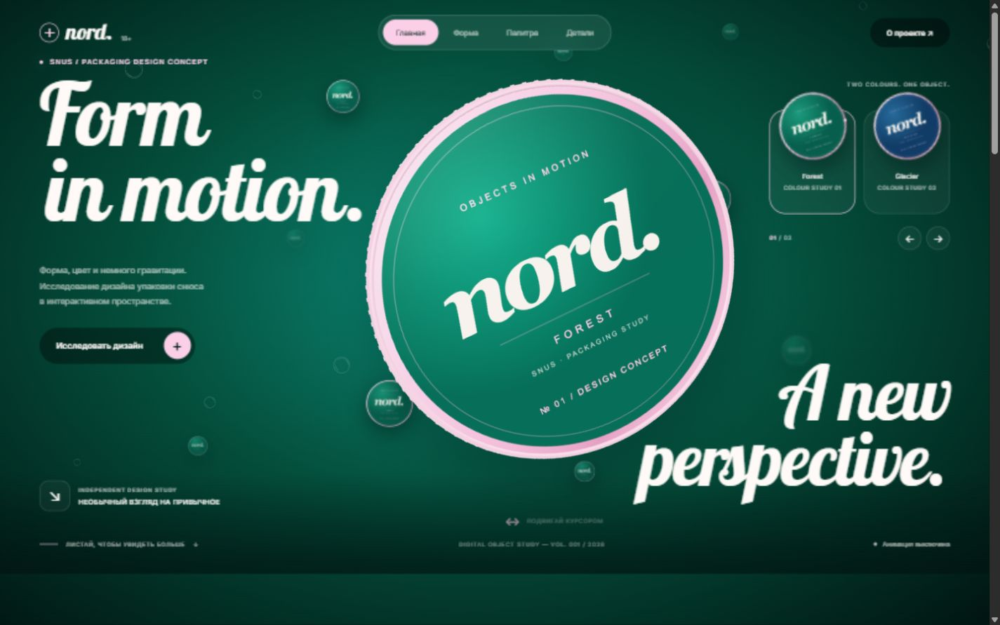
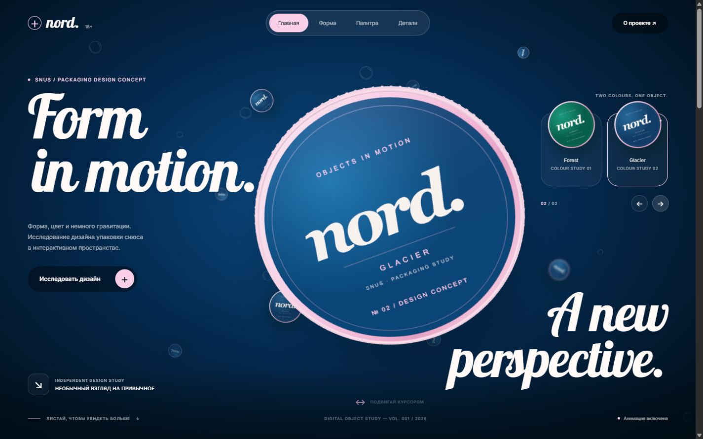
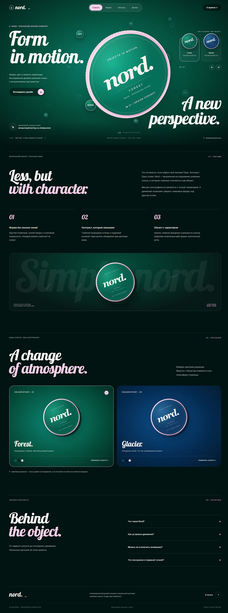
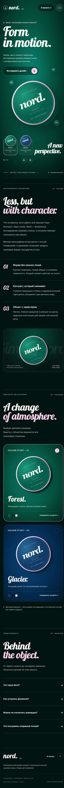

# Nord. — Form in motion

[](https://github.com/Aturm4/nord-design-study/actions/workflows/repository-checks.yml)

**Форма, цвет и движение в одностраничном дизайн-концепте.**

Некоммерческий портфолио-концепт о дизайне упаковки снюса. Один HTML-файл с CSS и JavaScript, локальные шрифты, GSAP и Google model-viewer. Сборка и API-ключи не нужны.



HTML / CSS / JavaScript · GSAP · model-viewer · Three.js · GLB

## Запуск

Нужен Node.js 20.11 или новее. В PowerShell:

```powershell
git clone https://github.com/Aturm4/nord-design-study.git
cd nord-design-study
npm run dev
```

Открыть **http://127.0.0.1:4173/**. Остановка сервера — `Ctrl+C`.

Для другого порта:

```powershell
npm run dev -- --port 4300
```

`npm install` для обычного запуска не требуется: браузерные библиотеки и все используемые ассеты уже находятся в `assets/`. Открывать через HTTP, а не двойным щелчком по HTML: ES-модулю и 3D-модели нужен локальный сервер.

## Что работает

- 3D-упаковка с реакцией на курсор на компьютере; плавучие объекты и параллакс.
- Два цветовых решения: Forest и Glacier. Цвет страницы меняется за 1,5 с; упаковка делает оборот 360° за 0,6 с и ещё 360° за 1,5 с. Текстура меняется между фазами. Окружение собирается к центру и возвращается.
- Навигация по четырём секциям, мобильное меню, FAQ, диалог «О проекте», возврат к началу.
- Переключатель движения с сохранением в `sessionStorage`. Системный `prefers-reduced-motion` имеет приоритет.
- На ширинах до 800 px — изображения WebP вместо WebGL. model-viewer на телефоне не импортируется; курсорный цикл не запускается. Вне первого экрана и в неактивной вкладке цикл тоже останавливается.
- Если WebGL недоступен, остаётся изображение упаковки.

## Файлы

| Путь | Содержимое |
| --- | --- |
| `index.html` | Страница, стили, адаптивность и поведение |
| `assets/models/` | Собственные 3D-модели упаковки GLB |
| `assets/textures/` | Текстуры для смены палитры |
| `assets/*.webp` | Лёгкие изображения для телефонов и карточек |
| `assets/fonts/` | Локальные Galada, Inter и Manrope |
| `assets/vendor/` | Браузерные GSAP и model-viewer |
| `scripts/serve.mjs` | Локальный сервер без зависимостей |
| `scripts/create-model.mjs` | Генерация оригинальной геометрии и текстур |
| `docs/verification.md` | Результаты проверки |
| `docs/screenshots/` | Скриншоты десктопной и мобильной версий |

## Проверка и изменение модели

```powershell
npm run check
```

Проверяет синтаксис JavaScript, локальные файлы, заголовки GLB, идентификаторы и якоря.

Для изменения геометрии или текстур нужны инструменты разработки:

```powershell
npm ci
npm run assets:model
```

После изменения модели обновить страницу в браузере. Для изменения текста, цветов и поведения достаточно редактировать `index.html` и обновить вкладку.

## Устройство проекта

Первый экран построен вокруг круглой упаковки Nord между двумя текстовыми колонками. Galada, стеклянная навигация и розовый акцент объединяют зелёную и синюю сцены. Ниже расположены прокручиваемые секции о форме, палитре и деталях проекта.

Адаптивная сетка и режим уменьшения движения учитывают размер экрана и системные настройки. Сторонние библиотеки и шрифты перечислены в [THIRD_PARTY.md](THIRD_PARTY.md).

## Скриншоты

<details>
<summary><strong>Glacier — второе цветовое решение</strong></summary>



</details>

<details>
<summary><strong>Полная страница на компьютере</strong></summary>



</details>

<details>
<summary><strong>Мобильная версия</strong></summary>



</details>

## Автоматические проверки

GitHub Actions проверяет исходники и локальные ресурсы, синтаксис служебных скриптов,
зависимости через `npm audit` и историю коммитов через Gitleaks.
Зависимости устанавливаются из lock-файла командой `npm ci`.

Локальные референсы, окружение разработки, секреты и внутренний скрипт подготовки
референса не входят в публичную копию проекта.

## Статический хостинг

Для публикации на GitHub Pages или другом статическом HTTPS-хостинге используются
`index.html` и каталог `assets/`. Пути относительные, сборка не требуется.
`scripts/serve.mjs` предназначен для локальной разработки.

Проект представляет вымышленный бренд, не содержит продажи, оформления заказов, аналитики или отправки пользовательских данных.

Автор: [Amir Turaev](https://github.com/Aturm4).
